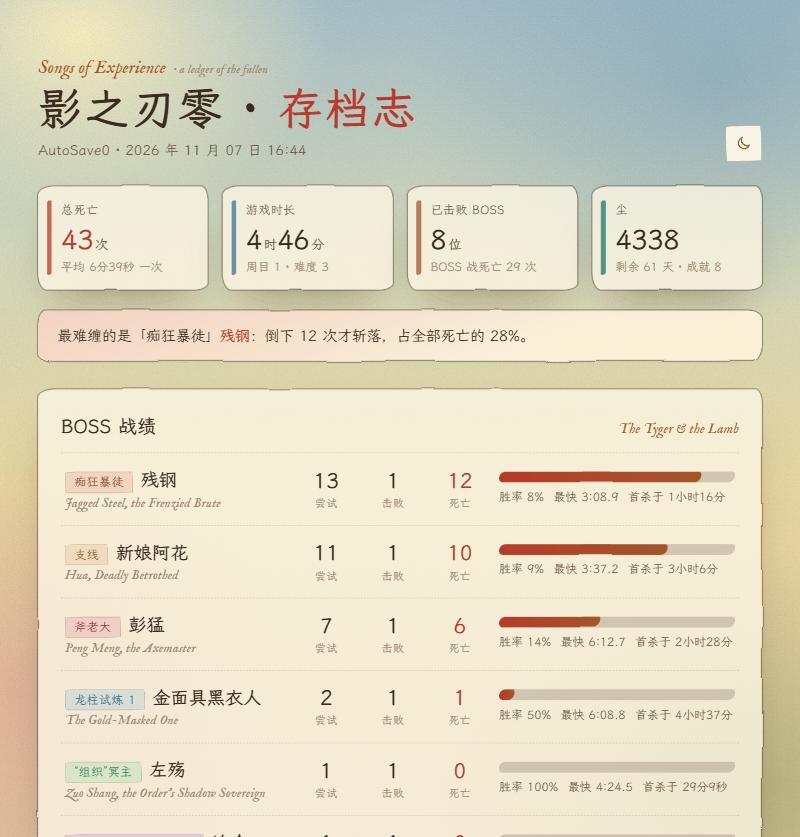

# HV影之刃零存档分析

《影之刃零》（Phantom Blade Zero）存档分析工具：读取存档，统计每个 BOSS 的尝试、击败、死亡次数和最快用时，画出死亡曲线，生成一份布莱克《天真与经验之歌》风格的 HTML 报告（日间 / 夜间两套主题）。



## 使用

需要 [Node.js](https://nodejs.org/) 18 或更新版本，无需安装其他依赖。

1. 下载或 clone 本仓库。
2. 双击 `run.bat`：控制台打印 BOSS 战绩，并生成 `report.html` 自动打开。

游戏目录默认 `D:\Games\Phantom Blade Zero`，不同的话：

```
node analyze.js "你的游戏目录" --open
```

游戏目录就是包含 `ProjectPBZ` 文件夹的那一层。HV 版和 Steam 版都可以：工具会在 `ProjectPBZ\Saved\SaveGames` 下（包括 `Steam\<SteamID>` 子文件夹）自动找 `PBZSaveGame.sav`，再找不到就去 `%LOCALAPPDATA%\ProjectPBZ` 找。

解密存档用的密钥**不随仓库分发**：第一次运行时从你自己的 `PBZ.exe` 里提取，缓存在本地 `key.txt`（已加入 .gitignore）。

## 报告内容

- 概览：总死亡、游戏时长、击败 BOSS 数、周目/难度、尘、剩余天数、成就、图鉴敌人数
- BOSS 战绩：每个 BOSS 的尝试、击败、死亡（尝试 − 击败）、胜率、最快用时、首杀时的游戏时长
- 其他死亡：总死亡 − BOSS 死亡
- 死亡曲线：用主存档的所有存档位 + `1RealTime / 2Hourly / 3Daily` 自动备份画出死亡数随游戏时长的变化，星标标出每个 BOSS 首杀
- 存档位列表

只读，不修改任何存档。

## 数据来源

- `PBZSaveGame.sav` 是 PBZS v3 容器：AES-256-GCM 加密 + Oodle 压缩的 JSON。
- 密钥第一次运行时从 `PBZ.exe` 提取（UTF-16 标记 `sealed but block is PLAINTEXT` 后 66 字节处的 64 字节，前后两半异或），缓存在 `key.txt`。游戏更新换了密钥就删掉 `key.txt` 重跑。
- 字段：`BossRecord.<类名>.Records.<周目_难度>.{AttemptCount, KillCount, BestTimeMs}`、`PBZDeathMeta.DiedTimes`、`PBZGameSystem.HasGameTime`（秒）。

## BOSS 名字

`names.json`：类名 → {名字, 称号, 英文}。已对照公开的 BOSS 列表（phantombladeatlas、游民星空、phantomblade.guide）：
左殇（“组织”冥主）、追命（“组织”猎杀者，HookMan 系列：马车战 / 本体 / P2）、残钢（痴狂暴徒，MobMan_Elite_Sword）、彭猛（斧老大）、新娘阿花、金面具黑衣人（MoTian_LongZhu_0N = 龙柱试炼 N）。
新出现的 BOSS 会先显示类名，自己补上即可；补了生僻字后跑一次 `python fonts.py`（字体源放 `_fonts/`）。

## 界面

和课表站同一套 William Blake《天真与经验之歌》风格：日间=天真，夜间=经验，右上角切换；中文霞鹜文楷、拉丁 IM Fell English，纸纹 `assets/paper.svg`。

## 许可

GPL-3.0（因为内置的 Oodle 解码器是 GPL-3.0）。字体是霞鹜文楷和 IM FELL English 的子集，均为 SIL OFL 1.1，见 `assets/FONTS.txt`。与 S-GAME 无关，非官方工具。

## 致谢

格式参考 [phantom-blade-zero-save-format](https://github.com/fancydirty/phantom-blade-zero-save-format) 和 [pbz-tracker](https://github.com/zziroo/pbz-tracker)。`vendor/oodle` 是 pbz-tracker 的纯 JS Oodle 解码器（移植自 ooz，GPL-3.0），见其中的 README.txt。
